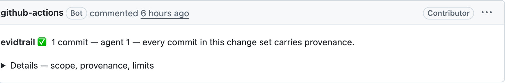

<h1 align="center">evidtrail</h1>

<p align="center">
  <strong>AI provenance for git: declared at commit time, checked in CI, traceable to the agent session. Honest about what git cannot prove.</strong><br/>
  <sub>formerly AIDA Metrics</sub>
</p>

<p align="center">
  <a href="https://www.npmjs.com/package/@evidtrail/cli"></a>
  <a href="https://www.npmjs.com/package/@evidtrail/core"></a>
  <a href="https://github.com/ceccode/evidtrail/blob/main/LICENSE"></a>
  <a href="https://github.com/ceccode/evidtrail/stargazers"></a>
</p>

<p align="center">
  <a href="#why-evidtrail">Why evidtrail</a> •
  <a href="#features">Features</a> •
  <a href="#installation">Install</a> •
  <a href="#usage">Usage</a> •
  <a href="#ai-detection">AI Detection</a> •
  <a href="#metrics">Report</a> •
  <a href="#cicd-integration">CI/CD</a> •
  <a href="https://ceccode.github.io/evidtrail/">Website</a> •
  <a href="CONTRIBUTING.md">Contributing</a>
</p>

---

## Why evidtrail?

More and more code is written by AI agents, and git keeps almost no record of it. Some commits carry a co-author line, many carry nothing, and nobody can check after the fact. evidtrail makes each commit state how it was produced, and checks that it did.

- **At commit time**, a git hook writes the autonomy level (`AI-Mode:`) and the tool (`Assisted-by:`, the trailer the Linux kernel, Fedora and LLVM ask for). If you opt in, it also writes the agent session the commit came from (`AI-Session:`). Nobody has to remember anything.
- **In CI**, `evidtrail verify` fails a pull request whose commits do not state their provenance, the way a DCO check fails a commit without `Signed-off-by`.
- **In the report**, provenance comes first: how much of the history is declared, inferred or silent. Silence stays `unknown`. It is never counted as human.

The report answers these questions:

- Which commits state how they were produced, and which say nothing?
- Which autonomy modes are declared, inferred, or unknown?
- Can a pull request be required to state its provenance, the way a DCO check requires Signed-off-by?
- After the commit: how often are files touched again, reverted, or hotfixed?

The first three are questions git can answer, and they lead the report. The last one is an appendix. It is useful for spotting where to look, and it cannot tell you whether AI-written code is good.

evidtrail is for teams and maintainers who may have to show what AI produced in their repository: a project with an AI contribution policy, a company answering an audit, a team tracing a change back to the session that made it. It is not a productivity score for people or models.

### What evidtrail is not

evidtrail does **not** infer productivity, defects, deployment, causality, capitalization, or developer performance from Git history. It does not measure the quality of AI-written code either: mistakes an agent finds and fixes inside its session, before anything is committed, leave no trace in history ([Between the Commits](https://arxiv.org/abs/2609.29744) shows this on a codebase written entirely by Claude). It does not estimate the value of software. Any number in a report is bounded by what the repository can actually establish, and the report says so next to the number.

### Renamed from AIDA Metrics

This project shipped as **AIDA Metrics** (`@aida-dev/*`) until 1.1. The name collided with the marketing funnel and an opera, and its expansion, "AI Development Accounting", promised the cost-and-value reading the tool refuses to make. The old names (`aida`, `.aida.json`, `AIDA_MODE`, `aida-attribution.json`, `<!-- aida-metrics-report -->`) were read until 1.3 and are gone in 2.0: a leftover `.aida.json` stops evidtrail with the `git mv` that fixes it, and a leftover `aida-attribution.json` is reported rather than silently ignored. The `AI-Mode:` trailer never carried the tool's name, so provenance already in your history stays valid.

## Features

- **Provenance, not guesses** — Declared, inferred, and missing evidence remain distinct; `unknown` is never silently called human
- **A provenance check for CI** — `evidtrail verify` fails a pull request whose commits do not state how they were produced; a repo-wide default never passes it
- **Reads the disclosure others already use** — `Assisted-by:` (Linux kernel, Fedora, LLVM) counts as a declaration, next to evidtrail's own `AI-Mode:`; the hook writes both
- **Commit-to-session link (opt-in)** — an `AI-Session:` trailer points an AI commit at the agent session that produced it; `evidtrail trail` follows it without opening the transcript
- **Autonomy when stated** — `none` / `autocomplete` / `assisted` / `agent` describes the declared level of participation, separately from how evidtrail knows
- **Configurable tool signals** — Add custom AI tools via `.evidtrail.json` or CLI flags; a tool signal proves involvement, not a precise autonomy mode
- **Change signals, as an appendix** — Fixed-horizon rapid-retouch rates for the whole repository, reverts and hotfixes, with eligible and too-recent counts; churn, not a quality score
- **Explicit Scope** — Default-branch ancestry by default; all refs and PR ranges are opt-in and labelled
- **Fast & Deterministic** — A metrics artifact is reproducible from the same collected snapshot; schemas reject incompatible inputs
- **Local by default** — Collection, analysis, blame, and reporting stay local; PR outcomes and comments are explicit network operations
- **CI comments** — GitHub Actions and GitLab CI can post a report with an explicit token and scoped permissions

## Installation

### Global CLI (Recommended)

```bash
npm install -g @evidtrail/cli
```

### From Source

Requires Node.js 22 or newer and pnpm.

```bash
git clone https://github.com/ceccode/evidtrail.git
cd evidtrail
pnpm install
pnpm build
```

## What the report shows

1. **Provenance**
   The share of commits that state how they were produced (`declared`), that evidtrail can attribute from a co-author or tool name (`inferred`), and that say nothing. Then the autonomy level of each commit, and how many AI commits link to an agent session. `unknown` stays a real answer, and a repository-wide default never counts as evidence.

2. **Change signals (appendix)**
   How often files are touched again within 7, 30 and 90 days, reverts, hotfixes, and their trend over time. These are churn signals, not a quality score: mistakes an agent fixes inside its session never reach git.


This is the opening of the report on this repository, which is written by an agent:

```markdown
## Provenance

**100.0% of commits carry provenance evidence** — declared 39 · inferred 11 · none 0 (0.0%).

**2 of the 39 AI commits link to an agent session** (1 distinct).

| Autonomy level | Commits |
|---|---:|
| agent | 39 |
| none (hand-written) | 0 |
| unknown | 0 |
| _automated (not authored)_ | 11 |
```

> evidtrail reports observations and their limits. It does not turn correlation into causality.

## Quick Start

### Using Global CLI

```bash
# Install globally
npm install -g @evidtrail/cli

# Navigate to your Git repository
cd /path/to/your/repo

# One-time setup: starter config, commit hook, prepare script, CI workflow.
# Additive — nothing that already exists is overwritten.
evidtrail init

# Check this clone before trusting a report (shallow? hook? config? CI?)
evidtrail doctor

# Run the whole pipeline: collect → analyze → report
evidtrail --since 90d
```

The first report is historical and may honestly contain `unknown`. To declare provenance for future commits, install the hook and configure a truthful mode through `EVIDTRAIL_MODE` or the repository's `.evidtrail.json`; when evidtrail cannot determine a mode, it writes no trailer.

```bash
evidtrail install-hooks
```

### Using from Source

```bash
# Install dependencies
pnpm install

# Build the project
pnpm build

# Collect commits from last 90 days
node packages/cli/dist/index.js collect --since 90d

# Analyze the data
node packages/cli/dist/index.js analyze

# Generate reports
node packages/cli/dist/index.js report
```

## For AI agents

[AGENTS.md](AGENTS.md) carries the working agreements for coding agents on this repo: how provenance is stamped, what counts as a regression test here, and the recurring defect class to watch for.

Security issues should be reported privately as described in [SECURITY.md](SECURITY.md). Repository paths, Git metadata, configuration, API responses, and generated artifacts are treated as untrusted input.

## Architecture

This is a TypeScript monorepo with three main packages:

- **`@evidtrail/core`** - Git collection, AI tagging, and data schemas
- **`@evidtrail/metrics`** - Attribution coverage and persistence calculations  
- **`@evidtrail/cli`** - Command-line interface for end users

## CLI Usage

### Commands

#### `evidtrail init`

Set up evidtrail in a repository in one command — `.evidtrail.json`, the commit hook for this clone, the `prepare` script for every other clone, and a GitHub workflow. Never overwrites: anything that exists is reported and left alone.

```bash
evidtrail init                       # add --default-mode agent to have the hook stamp it by default
evidtrail init --no-workflow         # skip .github/workflows/evidtrail.yml
```

#### `evidtrail doctor`

Ask every question that can make a run quietly wrong, before running: clone depth, partial clone, default branch, config validity, hook in this clone, `prepare` script, CI wiring. Non-green lines carry their fix; exit code is non-zero only for blockers.

```bash
evidtrail doctor
```

#### `evidtrail` / `evidtrail run`

With no subcommand (or explicitly as `evidtrail run`), runs `collect → analyze → report`. The granular commands below remain for CI and single-stage use.

```bash
evidtrail --since 90d
evidtrail run --since 90d --out-dir ./.evidtrail
```

#### `evidtrail collect`

Collect commits and generate normalized commit stream:

```bash
evidtrail collect --since 90d --out-dir ./evidtrail-output
```

#### `evidtrail install-hooks`

Install the commit-time mode stamping hook:

```bash
evidtrail install-hooks
```

#### `evidtrail trail`

Follow commits back to what they state about how they were produced, and to the agent session that produced them, when an `AI-Session:` trailer records one. Read-only and local; it never opens a transcript:

```bash
evidtrail trail HEAD~3 HEAD
evidtrail trail --json HEAD
```

#### `evidtrail blame`

Compute line-level attribution (slow, opt-in):

```bash
evidtrail blame --max-files 500
```

#### `evidtrail fetch-prs`

Fetch pull request outcomes from the forge API (**opt-in and networked; `evidtrail comment` is also networked**):

```bash
GITHUB_TOKEN=... evidtrail fetch-prs --github-repo owner/name --since 90d
```

#### `evidtrail analyze`

Calculate attribution coverage and persistence metrics:

```bash
evidtrail analyze --out-dir ./evidtrail-output
```

#### `evidtrail report`

Generate human-readable reports:

```bash
evidtrail report --out-dir ./evidtrail-output
```

The report opens with **Provenance**: coverage, how much of it is declared, and the autonomy table. **Change Signals** follows with its limit stated first: retouch, line survival, reverts, hotfixes and the per-autonomy comparisons are churn signals, not a quality score.

#### `evidtrail verify`

Fail when collected commits do not state their provenance. It reads the stream `collect` wrote, so for a pull request run `collect --pr` (or `--diff-base origin/main`) first:

```bash
evidtrail collect --diff-base origin/main
evidtrail verify                     # every commit declares: AI-Mode, Assisted-by or the manifest
evidtrail verify --require evidence  # any signal at all, a co-author line included
```

`AI-Mode: none` passes: the check asks that provenance be stated, not that it be AI. Merge commits and known bots are skipped. A `defaultMode` setting never passes, because a repository setting is not a statement about one commit. Exit codes: `0` all stated, `1` some commits state nothing, `2` the check could not run.

### Options

#### `evidtrail init`

- `--repo <path>` - Repository path (default: current directory)
- `--default-mode <value>` - Write `defaultMode` into `.evidtrail.json`, the mode the hook stamps when nothing else determines it: `none` | `autocomplete` | `assisted` | `agent` (default: none written)
- `--no-workflow` - Do not write `.github/workflows/evidtrail.yml`
- `--no-prepare` - Do not add the `prepare` script to `package.json`

#### `evidtrail doctor`

- `--repo <path>` - Repository path (default: current directory)
- `--json` - Machine-readable output

#### `evidtrail run` (also the default with no subcommand)

- `--repo <path>`, `--since <date>`, `--out-dir <path>`, `--verbose` - passed through to the pipeline

#### `evidtrail collect`

- `--repo <path>` - Repository path (default: current directory)
- `--since <date>` - Start date (ISO or relative like 90d)
- `--until <date>` - End date (ISO or relative)
- `--pr` - PR-scoped analysis (auto-detect base ref from CI env vars)
- `--diff-base <ref>` - Explicit base ref for PR-scoped analysis (e.g., `origin/main`)
- `--ai-pattern <pattern>` - Custom AI detection regex (repeatable)
- `--ai-tool <name>` - Additional AI tool name (repeatable; contributes inferred involvement evidence)
- `--ai-trailer-domain <domain>` - Additional Co-authored-by domain (repeatable)
- `--ai-bot-blocklist <name>` - Non-AI bot to exclude from trailer matching (repeatable)
- `--default-branch <name>` - Default branch name (auto-detect if omitted)
- `--scope <value>` - Commit universe: `default-branch` (default) or `all-refs`
- `--redact-authors` - Replace author/committer identities with a per-run salted hash (recommended in CI)
- `--out-dir <path>` - Output directory (default: ./evidtrail-output)
- `--verbose` - Verbose logging

#### `evidtrail analyze`

- `--coverage-threshold <fraction>` - Coverage below this flags metrics as low-confidence (default: 0.7)
- `--coverage-window <days>` - Window for the actionable coverage figure (default: 90)
- `--trend-granularity <value>` - Trend period: `month` | `quarter` (default: month)
- `--trend-window <days>` - Observation window applied equally to every trend period (default: 30)
- `--trend-periods <n>` - How many recent periods to report (default: 12)
- `--hotfix-window <days>` - Window for linking a hotfix to its likely antecedent (default: 7)
- `--out-dir <path>` - Output directory (default: ./evidtrail-output)
- `--verbose` - Verbose logging

#### `evidtrail report`

- `--out-dir <path>` - Output directory (default: ./evidtrail-output)
- `--verbose` - Verbose logging

#### `evidtrail install-hooks`

- `--repo <path>` - Repository path (default: current directory)
- `--force` - Overwrite an existing unrelated hook
- `--uninstall` - Remove the evidtrail hook block
- `--if-git` - Exit quietly when there is no git repository (for `prepare` scripts)
- `--verbose` - Verbose logging

#### `evidtrail blame`

- `--repo <path>` - Repository path (default: current directory)
- `--ref <ref>` - Git ref to blame (default: `HEAD`; use the collected stream's head when joining artifacts)
- `--max-files <n>` - Blame at most this many files, spread evenly across the tree (bounds runtime, flags the result as a sample)
- `--include-generated` - Also blame lockfiles and generated output
- `--out-dir <path>` - Output directory (default: ./evidtrail-output)
- `--verbose` - Verbose logging

#### `evidtrail fetch-prs`

- `--github-repo <owner/name>` - GitHub repository (default: `$GITHUB_REPOSITORY`)
- `--since <date>` - Only PRs closed after this date (ISO or relative like 90d)
- `--max-prs <n>` - Stop after this many PRs (bounds API usage)
- `--repo <path>` - Repository path, for reading `.evidtrail.json`
- `--out-dir <path>` - Output directory (default: ./evidtrail-output)
- `--verbose` - Verbose logging

Requires `GITHUB_TOKEN`. Without it the command refuses to run and PR acceptance stays **absent** from the report — never a silent 0%.

#### `evidtrail comment`

- `--out-dir <path>` - Output directory (default: ./evidtrail-output)
- `--dry-run` - Print report to stdout instead of posting
- `--verbose` - Verbose logging

## AI Detection

Message heuristics produce a detection **level**, which feeds the two axes above — `explicit` and `implicit` establish AI involvement, `mention` and `none` do not:

| Level        | Establishes AI? | Description                                            |
|--------------|-----------------|--------------------------------------------------------|
| **explicit** | yes             | Clear AI authorship — trailers, `[AI]` tag, creation verbs |
| **implicit** | yes             | AI involvement — suggestion/help language               |
| **mention**  | no              | Tool referenced but not used — "fix copilot bug"       |
| **none**     | no              | No AI reference                                        |

### Explicit Detection (high confidence)

- Git trailers: `AI: true`, `X-AI: true`
- `Assisted-by:`, the disclosure trailer the Linux kernel, Fedora and LLVM ask contributors to write. It is read as **declared** involvement with the autonomy level left `unknown`: `Assisted-by: Claude:claude-3-opus` says which model helped, not how much of the work it did. An `AI-Mode:` trailer on the same commit supplies the level. A hand-written `Assisted-by:` also outranks an `AI-Mode: none` stamped by a repo-wide prior.
- Co-authors: `Co-authored-by` that names a known AI tool or an AI domain (`anthropic.com`, `openai.com`)
  - **`github.com` is deliberately not an AI domain**: `@users.noreply.github.com` is the default email of every GitHub account, so matching it would flag ordinary humans who co-author through the web UI. AI bots hosted on GitHub (`copilot[bot]`, `copilot-swe-agent[bot]`) are caught by their tool name instead.
  - A co-author whose name only contains "bot" is not AI evidence: a project's own release or formatting bot is not a language model.
- `[AI]` / `[ai]` tags
- Creation verbs + tool name: "generated by copilot", "written with claude"

Non-AI automation bots (`dependabot`, `renovate`, `github-actions`, `greenkeeper`, `snyk-bot`, `mergify`, `imgbot`, `allcontributors`) are excluded from trailer matching by default, so their commits are not miscounted as AI. Extend the list via `botBlocklist` in `.evidtrail.json` or `--ai-bot-blocklist`.

### Implicit Detection

- Suggestion/help verbs + tool name: "copilot suggestions", "with help from claude"

### Mention (not counted as AI)

- Tool name in non-attribution context: "fix copilot bug", "add cursor support"
- Bare tool name without verb context

### Supported Tools (built-in)

`copilot`, `cursor`, `windsurf`, `codeium`, `claude`, `chatgpt`, `gemini`, `codex`

### Commit-Time Mode Stamping (git hook)

The manifest is retroactive; a hook is **prospective** — it declares provenance at the moment the commit is made, turning `declared` from the exception into the norm ([#61](https://github.com/ceccode/evidtrail/issues/61)).

```bash
evidtrail install-hooks          # writes .git/hooks/prepare-commit-msg
evidtrail install-hooks --uninstall
```

#### Installing it in every clone

A hook is **per-clone state**, while `.evidtrail.json` is committed and shared. So a repo can be set up for evidtrail while the clone in front of you declares nothing — and nothing visibly breaks: the no-evidence bucket just grows and the 90-day coverage figure degrades without anyone deciding it should ([#75](https://github.com/ceccode/evidtrail/issues/75)).

Meet people at the one command every clone runs:

```json
{
  "scripts": {
    "prepare": "evidtrail install-hooks --if-git"
  }
}
```

This repo follows its own advice — see [`scripts/install-hooks.mjs`](scripts/install-hooks.mjs). Because evidtrail *is* the CLI here, the bootstrap imports the canonical hook body directly and installs it before `pnpm build`; a clean `pnpm install` therefore produces the same hook the published CLI would write.

`--if-git` exits 0 silently where there is no git to hook into — a tarball install, `npm ci` in a container, a Docker build context — instead of failing an unrelated install. Installation is idempotent and still refuses to overwrite a hook evidtrail did not write, so `prepare` re-runs cost nothing.

evidtrail deliberately does **not** install the hook from a `postinstall` script: mutating `.git` as a side effect of `npm install` violates least surprise, and install scripts are disabled in exactly the hardened setups that would care most. When it notices the gap it says so instead — if a repo has `.evidtrail.json` but the local clone has no hook, the low-coverage warning names that specifically rather than repeating generic advice.

The hook appends an `AI-Mode:` trailer when the mode is known, and an `Assisted-by:` trailer when AI took part and the tool is known:

```
feat: add rate limiting

AI-Mode: agent
Assisted-by: Claude Code
```

`AI-Mode` is evidtrail's own convention and carries the autonomy level. `Assisted-by` is the one other projects already ask for, so a commit made with the hook also meets the kernel, Fedora or LLVM disclosure policy. The hook never guesses a tool name: with a mode but no known tool it writes only `AI-Mode`, and it never adds a second `Assisted-by` to a message that has one.

| Mode | Meaning |
|------|---------|
| `none` | Hand-written — the only mechanism that declares **human** authorship at commit time |
| `autocomplete` | Line-level suggestions |
| `assisted` | Supervised pair-programming |
| `agent` | Autonomous, multi-file work |

The mode describes **how the committed content was produced**, not who typed `git commit` or pushed the branch. If Codex, Claude Code, OpenCode, or another agent produced the change and a human reviewed and committed it manually, `agent` is still the truthful mode; Git's author/committer records the accountable person separately. Use `assisted` when the human substantially drove and wrote the implementation, and `none` only for genuinely hand-written work.

Resolution order: **`EVIDTRAIL_MODE`** env var (explicit and reliable — set it in your agent, wrapper, or shell alias) → auto-detection of known agent environments (best-effort convenience) → `defaultMode` in `.evidtrail.json` → **nothing**. When the mode is unknown the hook writes no trailer at all: an absent declaration honestly means unknown, while a guessed one would be a fabrication.

Auto-detection covers Claude Code (`CLAUDECODE`, `CLAUDE_CODE_ENTRYPOINT` → `agent`) and Cursor (`CURSOR_TRACE_ID` → `assisted`). Codex CLI documents no environment variable for the commands it spawns, so the hook does not guess at it: Codex users declare with `EVIDTRAIL_MODE=agent EVIDTRAIL_AGENT=Codex` in the agent's environment or a shell alias. `EVIDTRAIL_AGENT` also adds a model in the kernel's format, for example `EVIDTRAIL_AGENT="Claude Code:claude-opus-5-5"`. A detection that could be wrong is worse than an honest `unknown`.

`defaultMode` acts only at commit time. Prospectively, the installed hook turns the repository policy into an `AI-Mode:` declaration on each new commit; contributors must override it when that policy is not true for a particular change. Retroactively it does nothing: analysis records the setting and leaves old untagged commits `unknown`, because changing config today cannot prove how yesterday's code was produced. To declare old commits, list them in the attribution manifest. Like any self-declaration, a trailer is auditable evidence, not cryptographic verification.

```bash
EVIDTRAIL_MODE=agent git commit -m "feat: ..."
```

The hook is self-contained POSIX shell with no dependency on `evidtrail` being installed, never blocks a commit whatever happens inside it, refuses to overwrite a hook it didn't write (unless `--force`), and removes only its own block on uninstall.

**Honest limit**: a hook is voluntary and local to each clone. It shrinks the unknown bucket, it does not eliminate it — someone who doesn't install it, or unsets the variable, is invisible to it.

#### Linking commits to agent sessions (opt-in)

Git holds what an agent committed and nothing of what happened before: what it tried, what failed, what it fixed. In a codebase written entirely by an agent, errors found and fixed during a session left no trace in its commit history ([Between the Commits](https://arxiv.org/abs/2609.29744)). The session transcript keeps it. Each person opts in for their own commits, and the hook then gives each AI commit the address of its session:

```bash
git config evidtrail.recordSession true          # this clone
git config --global evidtrail.recordSession true # every repository with the hook
```

`EVIDTRAIL_RECORD_SESSION=1` in the environment does the same. It is a git setting rather than a `.evidtrail.json` key on purpose: the sessions are yours, and evidtrail 1.2 and earlier refuse a config file with keys they do not know.

```
feat: add rate limiting

AI-Mode: agent
AI-Session: claude-code/3a083123-96c6-48b5-86fe-52c9dbe942f6
```

Claude Code exposes its session id to the commands it runs (`CLAUDE_CODE_SESSION_ID`), and that id is the name of the transcript file. For other agents, set `EVIDTRAIL_SESSION=<agent>/<id>` yourself. Only AI commits get the trailer, and only a filename-safe id is written.

`evidtrail trail <commit>` follows a commit as far as the evidence goes:

```
$ evidtrail trail HEAD
1f2e3d4c5b6a  feat: add rate limiting
  provenance  agent · declared (trailer:AI-Mode)
  session     claude-code/3a083123-96c6-48b5-86fe-52c9dbe942f6
  transcript  /Users/you/.claude/projects/-Users-you-app/3a083123-96c6-48b5-86fe-52c9dbe942f6.jsonl
```

It never opens the transcript, and it looks only in the session store of agents whose layout it knows. When the transcript is on another machine it says so. The report counts how many AI commits carry a link.

**Privacy.** The id alone reveals nothing: it is a random identifier, and the transcript stays wherever the agent stored it. But a public history keeps every id forever, and anyone who later gets a transcript can match it to its commits. That is why this is off by default. Turn it on where you would be comfortable sharing a transcript to explain a commit.

### Attribution Manifest (`evidtrail-attribution.json`)

Heuristics only see what commit messages admit to. The manifest lets you declare attribution **retroactively and explicitly** — for commits made before your team adopted trailers, or to correct heuristic false positives. Place it at the repo root; `evidtrail collect` picks it up automatically ([#10](https://github.com/ceccode/evidtrail/issues/10)).

```json
{
  "version": "1.0",
  "tool": "windsurf",
  "model": "claude-opus",
  "mode": "agent",
  "note": "Commits made before Co-Authored-By trailers were adopted.",
  "ai_assisted_commits": [
    { "hash": "2f972ace3ff158fbe272d2850e879008abb0b197", "message": "first commit" },
    { "hash": "9f8e7d6c5b4a39281706f5e4d3c2b1a09876fedc", "message": "feat: inline suggestion", "mode": "autocomplete" }
  ],
  "human_authored_commits": [
    { "hash": "1a2b3c4d5e6f7a8b9c0d1e2f3a4b5c6d7e8f9a0b", "message": "fix: hand-written hotfix" }
  ],
  "excluded_commits": [
    { "hash": "1be7b68039b5156881c080def855c7d4dd30698d", "message": "chore: release packages", "reason": "Automated by changesets" }
  ]
}
```

| List | Effect |
|------|--------|
| `ai_assisted_commits` | Attribution `ai`, level `explicit`, source `manifest` |
| `human_authored_commits` | Attribution `human`, source `manifest` — declares hand-written history |
| `excluded_commits` | Declares attribution `automated` (overrides heuristics) — for automation the auto-detection misses (bots not in the blocklist, templates) |
| `mode` (top-level or per-entry) | Declares the autonomy level of `ai_assisted_commits`: `autocomplete` \| `assisted` \| `agent` ([#25](https://github.com/ceccode/evidtrail/issues/25)). Per-entry beats top-level. A manifest mode is `declared` evidence; without one, evidtrail infers a coarse mode from the tool named in trailers (`inferred`) |

Precedence: in-commit evidence beats retroactive declarations. A commit with an explicit AI trailer stays `ai` even if the manifest declares it human (with a warning); `excluded_commits` always wins, since it exists to correct heuristic false positives. Full hashes are matched exactly (`message` is documentation only); an invalid manifest logs a warning and is ignored — it never fails `collect`.

### Privacy: no leaderboards

evidtrail compares **cohorts of commits, never people**. This is a design constraint, not a default:

- No per-author metric will ever ship. Requests for per-developer breakdowns are out of scope by policy, not by omission.
- `commit-stream.json` carries author identities so identity-based detection (bots, #39) can work — but that file travels: committed to CI, uploaded as an artifact. Pass `--redact-authors` (or set `redactAuthors` in `.evidtrail.json`) to replace names and emails with a **per-run salted hash**: stable within one output file, so grouping still works, but not reversible to a person and not correlatable across runs.
- Redaction runs *after* detection, so enabling it costs no accuracy.

Git history itself is not anonymous, so nobody can stop a determined manager from writing their own script. What evidtrail can do is refuse to make it convenient ([#35](https://github.com/ceccode/evidtrail/issues/35)).

### Configuration File (`.evidtrail.json`)

Place a `.evidtrail.json` file in your project root to add custom tools, trailer domains, and patterns:

```json
{
  "tools": ["devbot", "codyai", "internal-copilot"],
  "trailerDomains": ["mycompany\\.com"],
  "botBlocklist": ["acme-ci-bot"],
  "patterns": ["my-custom-regex"],
  "defaultMode": "assisted",
  "coverageThreshold": 0.7
}
```

| Field | Description |
|-------|-------------|
| `tools` | Additional AI tool names — benefits from all 4 classification levels |
| `trailerDomains` | Additional domains for `Co-authored-by` trailer matching |
| `botBlocklist` | Additional non-AI bots to exclude from `Co-authored-by` trailer matching |
| `patterns` | Raw regex patterns (treated as explicit) |
| `defaultMode` | The repo's autonomy level when nothing else determines it. The commit hook stamps it as an `AI-Mode:` trailer, making new commits `declared`. Analysis records it and applies it to nothing: older commits with no evidence stay `unknown`. This repo sets `agent`. |
| `coverageThreshold` | Attribution coverage below this fraction (default `0.7`) flags attribution-dependent sections as low-confidence |
| `redactAuthors` | Replace author/committer identities in `commit-stream.json` with a per-run salted hash (default `false`; recommended in CI) |

### CLI Flags

Override or supplement `.evidtrail.json` via CLI:

```bash
evidtrail collect --ai-tool "devbot" --ai-tool "codyai"
evidtrail collect --ai-trailer-domain "mycompany.com"
evidtrail collect --ai-bot-blocklist "acme-ci-bot"
evidtrail collect --ai-pattern "my-custom-regex"
evidtrail analyze --coverage-threshold 0.8
```

## Metrics

### Provenance and autonomy

The primary model ([#25](https://github.com/ceccode/evidtrail/issues/25)). Every commit is described on **two orthogonal axes**:

| Axis | Values | Question |
|---|---|---|
| **Involvement** (`mode`) | `none` · `autocomplete` · `assisted` · `agent` · `unknown` | What level of AI participated? |
| **Evidence** | `declared` · `inferred` · `none` | How do we know? |

They are separate because they fail separately. `mode: unknown, evidence: inferred` is a real state — we know AI participated, we cannot say at what level — and the old single-axis model had to misreport it as "no evidence".

`declared` means someone stated it: the `AI-Mode:` or `Assisted-by:` trailer, or the attribution manifest. `inferred` means evidtrail concluded it from tool identity or commit structure. Automation ([#39](https://github.com/ceccode/evidtrail/issues/39) — merge commits, known bots, manifest `excluded_commits`) is a third, orthogonal flag: its provenance is known, so it counts toward coverage, but it stays off the autonomy table and out of the change signals, because automation is not authored code.

**Coverage** = share of commits with any evidence at all (`declared` + `inferred`). It opens the report, in the Provenance section. Under Change Signals, the breakdowns by attribution (outcomes, PR merges, line survival) describe only the commits with evidence; the repository-level rows need none and do not move with it.

**The three-state view survives as a projection.** `ai` (mode above `none`), `human` (declared `none`), `automated`, `unknown` (no evidence) are derived from the axes above — never decided independently — and kept because a headline needs one word. The rich model underneath, the one-line summary on top.

Why the axes and not the binary: for most teams today AI participates in nearly every commit, so "was AI involved?" trends to *yes* and stops discriminating anything. What a commit can still usefully state is **at what autonomy level**.

Coverage is reported over **two windows** ([#52](https://github.com/ceccode/evidtrail/issues/52)): all-time, and a recent window (default 90 days, `--coverage-window`). The recent figure is the actionable one — it answers *"are we tagging now?"* rather than passing a permanent verdict on history that predates adoption — so it is what drives the low-confidence warning below `coverageThreshold` (default 70%). All-time stays visible as context, never replaced.

### Change signals

Everything below is the report's appendix. It describes what happens to code after it lands: retouches, reverts, hotfixes, PR outcomes. These numbers are useful for deciding where to look. They do not measure whether AI-written code is good, because the mistakes an agent makes and fixes inside its session never reach git ([Between the Commits](https://arxiv.org/abs/2609.29744)).

### Trend

The comparator that replaces cohorts ([#77](https://github.com/ceccode/evidtrail/issues/77) step 3). Once AI participates in nearly every commit, "AI vs human" has no second side left — `No baseline cohort` becomes the normal outcome, not bad luck. What can still be compared is the repo with **its own past**: is code being touched again more or less often than before. That is a change in churn, not proof of a change in quality.

`metrics.trend` slices the same repo-level change signal by calendar period (month or quarter), derived from the commit stream in a single run — a team gets a trend the first time they run evidtrail, not after months of archiving reports.

Two mechanisms keep it honest, because the naive version is guaranteed to lie:

- **Every period is judged on the same fixed horizon** (`--trend-window`, default 30 days): a file counts as retouched only if it was touched again within that many days, so a period from last year gets no credit for having existed longer.
- **A period is *mature* only once it has been over for that full window.** Before then its files have had less time to be touched again than every earlier period. Immature periods are reported and marked, never compared — without this, *every report ever generated* would find retouch rising, because the newest period is always the least observed.

When fewer than two mature periods exist, evidtrail says so instead of drawing a line through one point.

### PR Merge Outcome

Merged vs closed-unmerged pull requests from the forge API ([#51](https://github.com/ceccode/evidtrail/issues/51)), broken down by attribution and autonomy level. Merge is an observable repository outcome, not proof of review quality, deployment, or business acceptance.

This is the successor to the removed git-only merge ratio. The forge preserves closed-unmerged outcomes that landed history cannot represent.

Two deliberate properties:

- **Opt-in and additive.** Collection, analysis, blame, and report generation stay local. `evidtrail fetch-prs` and `evidtrail comment` are the explicit network commands. `evidtrail fetch-prs` currently reads GitHub PR outcomes; `evidtrail comment` supports GitHub Actions and GitLab CI. Without a token the PR metric is absent, with a caveat saying so.
- **No author identity is ever fetched or stored.** `pr-stream.json` holds PR numbers, outcomes, dates, and the attribution of the PR's own commits — nothing that names anyone ([#35](https://github.com/ceccode/evidtrail/issues/35)).

PRs are attributed from **their own commit messages as returned by the API**, not from a join against local git. That is what makes this work for squash-merged PRs whose branches no longer exist — the exact case where git-based measurement failed.

### Why there is no Merge Ratio

Early versions shipped a merge ratio ("% of AI commits that land on the default branch"). We removed it ([#20](https://github.com/ceccode/evidtrail/issues/20)) because git history structurally cannot answer that question honestly:

- **Squash merges destroy the numerator's evidence** — branch commits vanish from history, so unmerged work disappears.
- **Survivorship bias destroys the denominator** — abandoned branches get deleted, so discarded work leaves `git log --all` entirely. The ratio trends toward 100% for everyone and discriminates nothing.

A rough metric with visible error bars is worth shipping; a metric whose data source systematically deletes the negative outcomes is not. The honest successor is the **PR acceptance rate** collected with `evidtrail fetch-prs` from forge APIs (GitHub/GitLab), where declined PRs are never deleted.

### Rapid Retouch

Share of files touched again within fixed 7, 30, and 90-day horizons ([#22](https://github.com/ceccode/evidtrail/issues/22)). The report gives the numerator, eligible denominator, too-recent count, and rate for every horizon.

**Right-censoring is handled explicitly**: a file first touched two days ago and not retouched has no known answer to a seven-day question, so it is excluded from the denominator and counted as too recent. A retouch already observed inside the horizon is a known outcome immediately.

**Honest limit**: it is file-level. A second touch can be normal iteration, review feedback, feature extension, formatting, or a defect fix. evidtrail therefore calls this *rapid retouch*, not rework, and never treats it as causality by itself.

Metric contract:

| Contract field | Definition |
|---|---|
| Commit universe | The stream's labelled scope: default-branch ancestry by default (prefers `origin/HEAD` when available), all refs or a PR range only when requested |
| Unit | A non-generated, non-migration file first touched by an authored (non-automated) commit |
| Entry time | Committer time of the first target touch, used as the local Git proxy for integration time |
| Event | The first topologically subsequent commit that modifies or deletes the same path |
| Censoring | Observation ends at `commit-stream.generatedAt`; files with no event and insufficient follow-up are `tooRecent` and excluded from the denominator |
| Horizons | Fixed at 7, 30, and 90 days; trend uses its configured fixed observation window |
| Permitted reading | “Of files with a known N-day outcome, X% were touched again within N days” |
| Forbidden reading | Defect rate, wasted work, productivity, causality, deployment, line survival, or developer performance |

### Line Survival (`evidtrail blame`)

Exact per-line attribution from `git blame` ([#23](https://github.com/ceccode/evidtrail/issues/23)) — of the lines alive in the tree right now, which commit last wrote each one, and at what autonomy level. This is the direct answer that file-level persistence could only approximate: one AI line in a thousand no longer marks a whole file.

```bash
evidtrail blame          # writes blame-stream.json
evidtrail analyze        # picks it up automatically when present
```

Kept in its own opt-in command because it runs one git process per file — the most expensive thing evidtrail does. Budget roughly 100ms per file: babel's 28,732-file tree is an hours-long run, where `collect` over the same repo takes 13 seconds. `--max-files` bounds the walk by striding evenly across the tree, so the sample spans the whole repo rather than the first N paths in alphabetical order, and the result is flagged as a sample. Binary files are detected and excluded, since `git blame` reports a whole blob as a single line rather than failing; files where blame genuinely errors (submodules, missing objects) are counted in `filesFailed` and warned about, never folded into the skipped count.

**What it measures exactly**: the living codebase — those share figures are precise. **What it cannot measure**: deleted lines, because blame only sees what survived. The derived "approximate survival of AI-introduced lines" is therefore labelled as approximate: a line rewritten twice was added twice, and additions to files since deleted or renamed fall outside the count. Both halves of that ratio are scoped to the files blame actually visited — otherwise a capped or filtered walk divides a fraction of the repo by all of it.

### Outcome Correlation

Whether AI-generated code causes more rework cannot be settled from git: most of the evidence (incidents, vulnerabilities) lives outside it, in PagerDuty/Jira/SAST tools, and pulling those in would need network access evidtrail deliberately doesn't have for its core commands ([#26](https://github.com/ceccode/evidtrail/issues/26)). Scoped to what git itself can answer:

- **Reverts**: a `git revert` writes "This reverts commit \<sha\>." into the generated commit's body — parsed at collect time into `revertsCommit`. `metrics.json`'s `outcomeCorrelation.reverts` reports how many were found and resolved, broken down by the **reverted** commit's attribution and autonomy mode.
- **Hotfixes**: commits matching a `fix`/`hotfix`/`patch` subject convention. Each is linked to the most recent prior commit that touched the same file(s), within a window (default 7 days, `--hotfix-window`) — the closest antecedent across all its files, so a hotfix touching several files links to whichever was most recently disturbed. `outcomeCorrelation.hotfixes` reports totals, how many were linked, and the antecedent's attribution/mode.

**Counts are reported against the base rate, never alone.** A cohort's share of reverts only means something next to its share of authored commits: in a repo that is 90% AI, 90% of reverts being AI is exactly what you'd expect and says nothing. Each row therefore carries `share`, `baseRate` and their `ratio` — **1.00× is what the cohort's size predicts**, above is an excess, below is better than average. Automated commits are excluded from both sides, since automation isn't authored work.

Validated on `anthropics/claude-code-action`: the raw counts (3 of 11 reverts, 49 of 140 hotfix antecedents) look alarming until the ratios show 1.13× for reverts — no signal at all — against 1.45× for hotfixes, a real but modest excess.

The ratios are descriptive, not causal, and on small counts a single commit moves them a long way.

Both are always present in `metrics.json` (a property of the repo, not a comparison between groups) and rendered in the report only when at least one is non-zero.

### Known Limits

These metrics are honest approximations, not ground truth. Read the numbers with these caveats in mind:

- **Shallow clones silently truncate everything** — `actions/checkout` defaults to `fetch-depth: 1` and GitLab CI to depth 20, which would make every metric describe a fragment of history. evidtrail detects this and warns, but the fix is on your side: set `fetch-depth: 0` / `GIT_DEPTH: 0`.
- **Detection is voluntary** — evidtrail only sees what commits admit to. Untagged AI code lands in the `unknown` bucket, and attribution coverage ([#34](https://github.com/ceccode/evidtrail/issues/34)) reports how big that bucket is instead of hiding it; the attribution manifest ([#10](https://github.com/ceccode/evidtrail/issues/10)) lets you shrink it retroactively. But the tool still cannot see through a commit that lies.
- **Git can't see discarded work** — squash merges and deleted branches erase unmerged commits, which is why the merge ratio was removed entirely rather than patched ([#20](https://github.com/ceccode/evidtrail/issues/20)). PR acceptance ([#51](https://github.com/ceccode/evidtrail/issues/51)) answers the question from the forge API instead.
- **The attribution manifest does not apply to PR commits** — manifest entries are keyed by hash, and a squash-merged PR's original commits have different hashes from what landed on the default branch. PR-level attribution therefore relies on trailers alone, so a repo that adopted trailers late will see more `unknown` PRs than `unknown` commits.
- **Rapid retouch is file-level** — any later commit touching the same file counts. `evidtrail blame` ([#23](https://github.com/ceccode/evidtrail/issues/23)) gives exact per-line attribution for the living codebase; the file-level figures remain as the fast path.
- **No AI-vs-human comparison of change signals** — until 1.3 the report compared retouch rates by autonomy level and against a human baseline, with age and task-mix corrections. 2.0 removed them: in most repositories one side is empty, and where both exist the difference reflects what each group worked on more than how good the code is.
- **Outcome correlation is git-only** — hotfix linking is a heuristic (closest prior touch within a window, not proven causation), and a chained hotfix attributes to the immediately preceding fix rather than the original commit. Incidents and vulnerabilities aren't represented at all ([#26](https://github.com/ceccode/evidtrail/issues/26)).

## Output Files

- `commit-stream.json` - Normalized commit data on the two axes: autonomy `mode` and `evidence`, with the three-state `attribution` derived from them
- `metrics.json` - Evidence coverage and autonomy counts (`attribution`), repository change signals (`repo`), trend, outcomes, and the optional PR and line-survival blocks
- `blame-stream.json` - Per-commit surviving line counts (only when `evidtrail blame` ran)
- `pr-stream.json` - PR outcomes and per-PR attribution (only when `evidtrail fetch-prs` ran)
- `report.md` - Human-readable Markdown report

### Schema versioning

Both JSON files carry a `schemaVersion` ([#53](https://github.com/ceccode/evidtrail/issues/53)). The contract:

- **Additive changes** (a new field) do **not** bump the version — consumers keep working.
- **Removing a field, renaming it, or changing its meaning** bumps `schemaVersion`.
- Readers **refuse** a version they don't understand rather than parsing it half-way: `evidtrail analyze` on a stale `commit-stream.json` fails with `Rerun 'evidtrail collect'`, not a silent wrong result.

Current: `commit-stream.json` **v3**, `metrics.json` **v3**, `pr-stream.json` **v2**, `blame-stream.json` **v3**.

The v3 contract binds artifacts to a labelled commit scope and head snapshot, makes default-branch ancestry the default universe, and adds fixed-horizon rapid-retouch outcomes. Blame v3 carries its HEAD for join validation; PR v2 labels incomplete commit lists.

## CI/CD Integration

### GitHub Actions (with PR comments)

The shortest path is the composite action. It runs `evidtrail doctor` first, so a shallow checkout is refused before it can produce a confidently wrong report, and it posts the comment in its own step so the write token never meets PR-built code:

```yaml
permissions:
  contents: read
  pull-requests: write

steps:
  - uses: actions/checkout@v5
    with:
      fetch-depth: 0
  - uses: ceccode/evidtrail@v2
    with:
      comment: true
```

This is what lands on the pull request when every commit carries provenance — one line, with scope, evidence and limits folded underneath:

<p align="center">
  
</p>

When commits lack provenance the line turns to ⚠️ with the count and coverage, followed by the commits themselves and the one-line repair. Nothing is repeated on every PR that does not need to be read on every PR.

To make provenance a requirement rather than a comment, set `require-provenance`. The job then fails on a pull request with a commit that states nothing, after the comment has been posted:

```yaml
  - uses: ceccode/evidtrail@v2
    with:
      require-provenance: declared   # or `evidence` to accept any signal
```

If you prefer to run the steps yourself, the job that posts comments needs `contents: read` and `pull-requests: write`; organizations that default `GITHUB_TOKEN` to read-only must declare these permissions explicitly.

```yaml
- uses: actions/checkout@v5
  with:
    # REQUIRED: the default (fetch-depth: 1) gives evidtrail a single commit,
    # and every metric would then describe that fragment as if it were
    # the whole history. evidtrail warns when it detects a shallow clone.
    fetch-depth: 0

- name: Install evidtrail
  run: npm install -g @evidtrail/cli

- name: Run evidtrail Analysis
  run: |
    evidtrail collect --pr
    evidtrail analyze
    evidtrail report
    evidtrail comment
  env:
    GITHUB_TOKEN: ${{ secrets.GITHUB_TOKEN }}

- name: Upload Reports
  uses: actions/upload-artifact@v4
  with:
    name: evidtrail-reports
    path: evidtrail-output/
```

`evidtrail comment` auto-detects the CI provider and posts the report as a PR comment. On subsequent pushes, it **updates** the existing comment instead of creating duplicates.

Use `--dry-run` to print the report to stdout without posting.

### PR-Scoped vs Time-Based Analysis

Use `--pr` for PR-specific metrics (analyzes only commits in the current PR):

```bash
evidtrail collect --pr              # Auto-detect base ref from CI env vars
evidtrail collect --diff-base origin/main  # Explicit base ref
```

Or use `--since` for time-based analysis:

| Approach | `--since` | Best for |
|----------|-----------|----------|
| Per-PR | `--pr` | PR-specific metrics (recommended) |
| Sprint report | `14d` or `30d` | Sprint retrospectives, scheduled runs |
| Monthly audit | `90d` | Management/finance reporting |
| Full history | *(omit)* | One-time baseline analysis |

### GitLab CI (with MR comments)

```yaml
evidtrail:
  rules:
    - if: $CI_PIPELINE_SOURCE == "merge_request_event"
  variables:
    GITLAB_TOKEN: $EVIDTRAIL_GITLAB_TOKEN
    # REQUIRED: GitLab shallow-clones by default (depth 20). evidtrail warns
    # when it detects one, since truncated history skews every metric.
    GIT_DEPTH: 0
  script:
    - npm install -g @evidtrail/cli
    - evidtrail collect --pr --redact-authors
    - evidtrail analyze
    - evidtrail report
    - evidtrail comment
  artifacts:
    paths:
      - evidtrail-output/
```

`evidtrail comment` auto-detects GitLab CI and posts the report as a merge request note, updating its own note on re-runs instead of adding new ones ([#16](https://github.com/ceccode/evidtrail/issues/16)).

**Token**: set `GITLAB_TOKEN` to a project or group access token with the `api` scope. The built-in `CI_JOB_TOKEN` cannot post notes, so it is deliberately not used as a fallback — the command fails with that explanation rather than an opaque 401.

Bitbucket is currently out of scope ([#17](https://github.com/ceccode/evidtrail/issues/17) closed); the `CIProvider` interface stays provider-agnostic if someone wants to add it.

## Repository Structure

```bash
/evidtrail
├── packages/
│   ├── cli/           # @evidtrail/cli
│   ├── core/          # @evidtrail/core
│   └── metrics/       # @evidtrail/metrics
├── .github/workflows/ # CI/CD automation
└── docs/             # Landing page (GitHub Pages)
```

## Roadmap

- **v0.1** ✅ Git-based metrics (Merge Ratio + Persistence).  
- **v0.2** ✅ AI detection for Claude Code, ChatGPT, Gemini, Copilot, Cursor, Windsurf, Codeium.  
- **v0.3** ✅ Attribution classification: explicit / implicit / mention / none ([#7](https://github.com/ceccode/evidtrail/issues/7)).  
- **v0.4** ✅ PR comment integration for GitHub Actions.  
- **v0.5** ✅ PR-scoped analysis with `--pr` and `--diff-base` flags ([#18](https://github.com/ceccode/evidtrail/issues/18)).  
- **v0.6** ✅ Comparative baseline — AI vs non-AI metrics with delta ([#19](https://github.com/ceccode/evidtrail/issues/19)).  
- **v0.7** ✅ Exclude non-AI bots (dependabot, renovate, …) from trailer matching, with configurable blocklist ([#21](https://github.com/ceccode/evidtrail/issues/21)).  
- **v0.8** ✅ Attribution coverage as headline metric — three-state `ai`/`human`/`unknown`, `defaultAttribution` prior, nullable baseline ([#34](https://github.com/ceccode/evidtrail/issues/34)).  
- **v0.9** ✅ Attribution manifest — retroactive `ai`/`human`/`excluded` declarations via `evidtrail-attribution.json` ([#10](https://github.com/ceccode/evidtrail/issues/10)).  
- **v0.10** ✅ Cohort fairness context — age stats ([#29](https://github.com/ceccode/evidtrail/issues/29), step 1) and task mix by file category ([#36](https://github.com/ceccode/evidtrail/issues/36), step 1) per cohort.  
- **v0.11** ✅ Autonomy mode collection — `mode` × `evidence` per commit, manifest declarations, tool inference ([#25](https://github.com/ceccode/evidtrail/issues/25), step 1).  
- **v0.12** ✅ `automated` attribution state — merge commits and bots auto-detected, coverage counts known automation ([#39](https://github.com/ceccode/evidtrail/issues/39)).  
- **v0.13** ✅ Per-mode cohort metrics — persistence per autonomy level ([#25](https://github.com/ceccode/evidtrail/issues/25), step 2).  
- **v0.14** ✅ Merge ratio removed — git cannot measure it honestly; PR acceptance rate via forge APIs is the successor ([#20](https://github.com/ceccode/evidtrail/issues/20)).  
- **v0.15** ✅ Author redaction ([#35](https://github.com/ceccode/evidtrail/issues/35)) and synthetic PR merge commit fix ([#40](https://github.com/ceccode/evidtrail/issues/40)).  
- **v0.16** ✅ Versioned output schemas with reader-side version gate, plus end-to-end CLI tests and `pnpm typecheck` in CI ([#53](https://github.com/ceccode/evidtrail/issues/53)).  
- **v0.17** ✅ PR acceptance rate via forge APIs — opt-in `evidtrail fetch-prs`, the honest successor to merge ratio ([#51](https://github.com/ceccode/evidtrail/issues/51)).  
- **v0.18** ✅ Commit-time mode stamping via git hook — `AI-Mode` trailer, `declared` evidence at the source ([#61](https://github.com/ceccode/evidtrail/issues/61)).  
- **v0.19** ✅ Windowed coverage ([#52](https://github.com/ceccode/evidtrail/issues/52)) and rework rate with censoring ([#22](https://github.com/ceccode/evidtrail/issues/22)).  
- **v0.20** ✅ GitLab CI provider — MR comments with note reuse ([#16](https://github.com/ceccode/evidtrail/issues/16)).  
- **v0.21** ✅ Line-level survival via `evidtrail blame` — exact per-line attribution, binaries excluded ([#23](https://github.com/ceccode/evidtrail/issues/23)).
- **v0.22** ✅ Age-normalized fair comparison ([#29](https://github.com/ceccode/evidtrail/issues/29)), within-category comparison ([#36](https://github.com/ceccode/evidtrail/issues/36)), git-scoped outcome correlation — reverts and hotfixes ([#26](https://github.com/ceccode/evidtrail/issues/26)).  
- **v0.23** ✅ Autonomy as the primary axis — involvement × evidence, with three-state attribution demoted to a derived projection; coverage measured on the evidence axis; `defaultAttribution` replaced by `defaultMode` ([#25](https://github.com/ceccode/evidtrail/issues/25)). Schema v2.
- **v0.24** ✅ `--if-git` and a documented `prepare` recipe, so hook installation reaches every clone; the low-coverage warning names a missing hook in a configured repo ([#75](https://github.com/ceccode/evidtrail/issues/75)).
- **v0.25** ✅ Quality-first, steps 1–2 ([#77](https://github.com/ceccode/evidtrail/issues/77)): repo-level `repo` block in `metrics.json` (cohort-free persistence and rework, prior-proof), and the report reframe — Code Quality opens, the autonomy lens follows, coverage demoted to a Data Quality footnote.
- **v0.26** ✅ Quality over time, step 3 ([#77](https://github.com/ceccode/evidtrail/issues/77)): `metrics.trend` — per-period persistence, rework and coverage derived from the commit stream in a single run, every period measured through the same observation window, immature periods reported but never compared.
- **v0.27** ✅ Overlay gating, step 4 ([#77](https://github.com/ceccode/evidtrail/issues/77)) — cohort tables render only where real evidence backs them; a `defaultMode` prior can no longer conjure an autonomy cohort or a baseline comparison out of assumption alone. Completes the quality-first migration.
- **v1.0** ✅ Security and measurement contract: shell-free Git execution, default-branch scope, snapshot-bound schema v3, deterministic analysis, fixed-horizon rapid retouch, complete/labelled PR collection, and minimum-permission CI.
- **v1.1** ✅ `init` and `doctor` for the first ten minutes; a one-line PR comment that only grows when commits lack provenance.
- **v1.2** ✅ Renamed from AIDA Metrics to evidtrail. In 1.2.1, observation stops at `--until`, and the trend says when two periods are too different in size to compare.
- **v1.3** ✅ Provenance first: `Assisted-by:` read and written ([#107](https://github.com/ceccode/evidtrail/pull/107)), `evidtrail verify` and a report that opens with Provenance ([#108](https://github.com/ceccode/evidtrail/pull/108)), commit-to-session links with `AI-Session:` and `evidtrail trail` ([#109](https://github.com/ceccode/evidtrail/pull/109)).
- **v2.0** ✅ Provenance only: the cohort comparisons (AI vs Baseline, fair comparison, within-category, by autonomy level) and the pre-1.0 follow-up fields are removed, `defaultMode` acts only at commit time, and the AIDA-era names are retired. Metrics schema v4.
- **Next** → Depends on who needs provenance, and for what. Candidates: session ids for agents other than Claude Code, `verify` for GitLab, and following the trailer conventions the ecosystem settles on. The change signals are maintained, not extended.

### Direction: from measuring AI code to stating its provenance

Until 1.2 the main question was *"does AI-written code hold up?"*, answered with churn from git history. That question turned out to sit mostly outside git: an agent's mistakes are made and fixed inside its session, and churn says little about accuracy ([Between the Commits](https://arxiv.org/abs/2609.29744)). So the direction changed:

- **Provenance over quality** — what git can answer is what each commit states about how it was produced. The report opens with that, and the change signals become an appendix that says what it cannot show.
- **Use the conventions that exist** — `Assisted-by:` is what the Linux kernel, Fedora and LLVM ask contributors to write. evidtrail reads it and writes it, next to its own `AI-Mode:`, instead of asking everyone to adopt a private format.
- **Make it checkable** — `evidtrail verify` turns provenance into a CI check, like DCO does for `Signed-off-by`. A repository-wide default never passes it.
- **Point to where the evidence is** — when the interesting part happened in the session, the commit should say which session. `AI-Session:` is opt-in per person, and evidtrail never reads the transcript.
- **Autonomy over the binary** — `none` / `autocomplete` / `assisted` / `agent` × `declared` / `inferred` / `none` ([#25](https://github.com/ceccode/evidtrail/issues/25)) is the model. The AI/human/unknown view remains as a projection.
- **Cohorts, not people** — evidtrail compares groups of commits, never developers. No per-author aggregation will ever ship, and author identity can be redacted from output artifacts ([#35](https://github.com/ceccode/evidtrail/issues/35)).

## Contributing

This is just the starting point. We are looking for contributors who can help with:  

- Provenance conventions and other agents' session ids  
- Building integrations
- Improving analysis pipelines  
- Validating approaches with real-world projects  

### Git Workflow

We use a simple, main-branch workflow with automated publishing:

1. **Create Feature Branch**

   ```bash
   git checkout -b feat/your-feature-name
   # or
   git checkout -b fix/bug-description
   ```

2. **Make Changes & Commit**

   ```bash
   git add .
   git commit -m "feat: add new feature"
   ```

3. **Add Changeset** (for version bumps)

   ```bash
   pnpm changeset
   # Select packages to version
   # Choose version bump type (patch/minor/major)
   # Add description for changelog
   ```

4. **Open Pull Request**
   - Target: `main` branch
   - Include changeset file if versioning needed
   - Describe changes and testing

5. **Merge & Auto-Publish**
   - Once merged, GitHub Actions automatically publishes to NPM
   - Feature branch gets deleted after merge

### AI Attribution Convention

`pnpm install` installs the commit hook through the `prepare` script. Inside Claude Code or Cursor it writes `AI-Mode:` and `Assisted-by:` for you; elsewhere `.evidtrail.json` sets the default mode for this repository. If you write a commit without the hook, add the trailer yourself and only state what is true:

```bash
git commit -m "feat: add new feature

AI-Mode: assisted
Assisted-by: GitHub Copilot"
```

Co-author trailers such as `Co-Authored-By: Claude <noreply@anthropic.com>` are read as well. [AGENTS.md](AGENTS.md) has the full rules.

### Branch Rules

- **Main branch only** - no separate dev/release branches
- **Feature branches** - `feat/xyz`, `fix/abc`, `docs/update-readme`
- **Clean history** - squash merge preferred
- **Auto-publish** - changesets trigger NPM releases

Feel free to open an **Issue** or start a **Discussion**.

## Call to Action

AI now writes most of the code in many repositories, and git barely records it. Before building further, this project wants to know one thing:

**A year from now, who will need to prove what AI produced in their repository, and to whom?**

If you have an answer, or a reason to think nobody will, open a [Discussion](https://github.com/ceccode/evidtrail/discussions).

## Development

```bash
# Install dependencies
pnpm install

# Build all packages
pnpm build

# Run tests
pnpm test

# Format code
pnpm format

# Lint code
pnpm lint
```

## Tech Stack

- **Language**: TypeScript (strict mode)
- **Package Manager**: pnpm with workspaces
- **Build**: tsup (ESM output)
- **Testing**: vitest with coverage
- **Git**: simple-git for repository analysis
- **Validation**: zod for schema validation
- **CLI**: commander for command-line interface

## Code of Conduct

This project and everyone participating in it is governed by our [Code of Conduct](CODE_OF_CONDUCT.md). By participating, you are expected to uphold this code.

## License

MIT License
